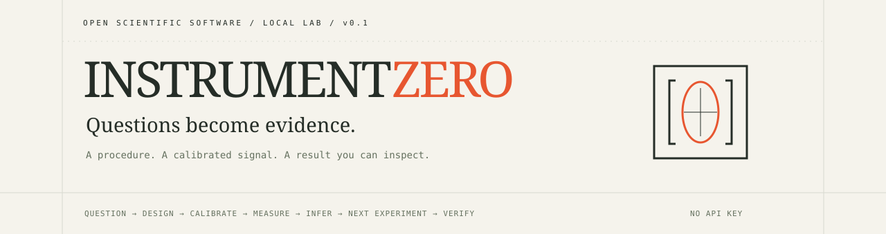
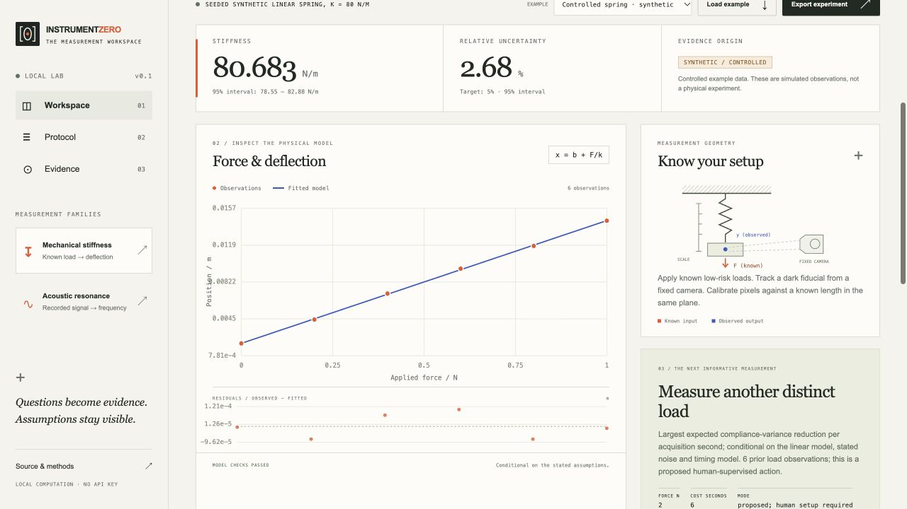
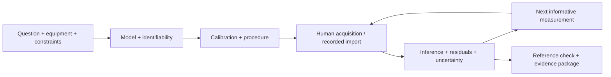
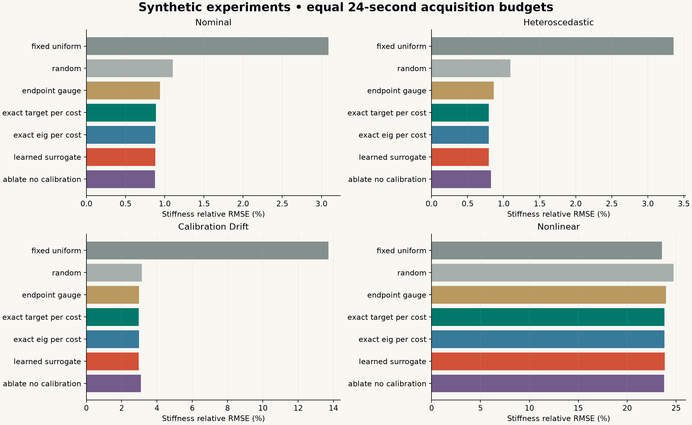

<p align="center"></p>

[](https://github.com/nazeeh111/InstrumentZero/actions/workflows/ci.yml)
[](LICENSE)
[](pyproject.toml)

**Ask a question about the physical world. Compile a way to measure it.**

InstrumentZero is a local scientific experiment compiler: supported questions become a procedure, a calibration contract, executable analysis, an uncertainty estimate, and a proposed next observation. Its Lab shows the assumptions beside the signal. It runs without an API key or paid model service.

> **Research preview v0.1.** Working force–deflection and acoustic workflows, authentic recordings, a reproducible adaptive-design study, and exportable analysis. The compiler is bounded to these models. Physical camera/microphone capture and independently calibrated webcam stiffness have not been validated in this release. See [evidence and limits](docs/VALIDATION.md).

## From an ordinary question to a measurement

**“How stiff is this spring?”** Supply known forces and calibrated video positions or an SI displacement CSV. Fit the unknown offset and compliance, propagate shared length/force calibration uncertainty, and convert a positive compliance interval into stiffness. Then compare feasible loads by expected variance reduction per second. A recommendation remains a proposal until someone actually makes the measurement.

The controlled example estimates **80.68 N/m** for a simulated 80 N/m spring and proposes **2 N** as the next load. It is a labeled simulation. A recorded nickel-sensor example uses real loading/unloading observations and flags model inconsistency under explicitly assumed noise. Precision cannot rescue an incorrect model.



[Watch the 20-second Lab walkthrough](https://github.com/nazeeh111/InstrumentZero/releases/download/v0.1.0/instrumentzero-demo.mp4) · [Editable walkthrough source](assets/launch-v0.1/)

**“What is this sound’s resonance?”** Import audio or deliberately record a microphone. The authentic CC0 tuning-fork example estimates approximately **440.21 Hz**. Its creator-stated 440 Hz label is a nominal comparison, not a traceable frequency certificate. Its envelope includes resolution, window variability and declared clock uncertainty; arbitrary-audio 95% coverage is not established.

## Run the Lab

Python 3.11 or newer; Python 3.13 was used for release evidence.

```sh
git clone https://github.com/nazeeh111/InstrumentZero.git
cd InstrumentZero
python3 -m venv .venv
source .venv/bin/activate
python -m pip install -e .
instrumentzero lab
```

Open **http://127.0.0.1:8765**. For an occupied port, use `instrumentzero lab --port 8781`. Windows activation: `.venv\Scripts\activate`.

No sensor starts automatically. Load labeled examples, import measurements, or choose a camera/microphone after arranging a suitable experiment. Selected numeric signals go to the loopback Python engine. There is no telemetry or cloud model call. The camera tracker retains captured pixel positions, not video footage. Keep original recordings and calibration records.

## The compiler



- **Measure honestly:** explicit N, m, Hz and seconds; unknown offsets; positive-parameter checks; distinct-load and sampling requirements.
- **Keep calibration shared:** another thousand frames cannot average away the same incorrect pixel scale or clock.
- **Challenge the model:** inspect curvature, residual inconsistency, competing peaks, clipping, silence, boundary leakage and nonstationarity.
- **Take the evidence with you:** ZIPs include exact observations, calibration, source digests, procedure, assumptions, result, environment and executable engine source.
- **Choose deliberately:** exact target-variance/cost design is the default. A compact learned acquisition model is trained and evaluated rather than promoted without evidence.

## CLI and Python

```sh
instrumentzero demo stiffness
instrumentzero demo stiffness --recorded
instrumentzero demo acoustic
instrumentzero compile examples/stiffness-spec.json
instrumentzero analyze examples/stiffness-spec.json examples/stiffness.csv --export spring.zip
instrumentzero analyze examples/acoustic-spec.json data/tuning-fork-440Hz.wav --export resonance.zip
```

```python
import csv, json
from instrumentzero import MeasurementSpec, compile_experiment, analyze_stiffness
spec = MeasurementSpec.parse(json.load(open("examples/stiffness-spec.json")))
plan = compile_experiment(spec)
with open("examples/stiffness.csv", newline="") as stream:
    result = analyze_stiffness(spec, list(csv.DictReader(stream)))
print(result["quantity"], result["next_experiment"])
```

[Tutorial](docs/TUTORIAL.md) · [API and units](docs/API.md) · [Coding-agent integration](docs/AGENT_INTEGRATION.md) · [Adapter boundaries](docs/ADAPTERS.md)

## Does adaptive design help?

The [technical report](docs/RESEARCH.md) includes **5,400 paired synthetic trials**, nine policies, four regimes, equal acquisition budgets, a learned surrogate, calibration/cost ablations and confidence intervals. Data and weights are retained in [benchmarks/release-0.1.0](benchmarks/release-0.1.0).

| Nominal simulated protocol | Stiffness relative RMSE |
|---|---:|
| Uniform video | 3.09% |
| Fixed gauge endpoints | 0.94% |
| Exact target variance / cost | 0.89% |
| Learned acquisition surrogate | 0.88% |

Adaptive design beats uniform video largely by choosing a more precise, better-calibrated modality. Its nominal advantage over fixed gauge endpoints is statistically uncertain. The learned model is slower and adds no demonstrated practical benefit, so it does not replace the cheap exact calculation.

Ignoring calibration cuts nominal interval coverage to **60.7%**. Unmodeled drift cuts exact-design coverage to **34%**. A wrong linear model produces roughly **24% error and zero coverage** in the nonlinear stress test. These failures are part of the release.



## Reproduce and contribute

The [data inventory](docs/DATA.md) separates unchanged source files, conversions and assumptions. Authentic sources include a CC0 microphone recording, NIST load-cell observations, and Dera et al.’s CC BY force-sensor observations. None was collected live by InstrumentZero. Published coefficient agreement is a numerical check; held-out reference observations have narrower independence than a new calibrated laboratory experiment.

```sh
python -m pip install -e '.[dev]'
python -m pytest -q
python data/reproduce.py
python scripts/validate_real.py --output examples/my-validation
python scripts/benchmark.py --trials 150 --training-states 1500 --output benchmarks/my-run
```

Use fresh evaluation output directories. See [contribution opportunities](CONTRIBUTING.md), [release notes](CHANGELOG.md), [research foundations](docs/FOUNDATIONS.md), and [security boundaries](SECURITY.md).

Code is **MIT**. Data and the retained paper have separate terms in [THIRD_PARTY_NOTICES.md](THIRD_PARTY_NOTICES.md). InstrumentZero builds on NumPy/SciPy and established experimental-design research. It does not claim to invent Bayesian design, learned sequential policies or general autonomous science.
