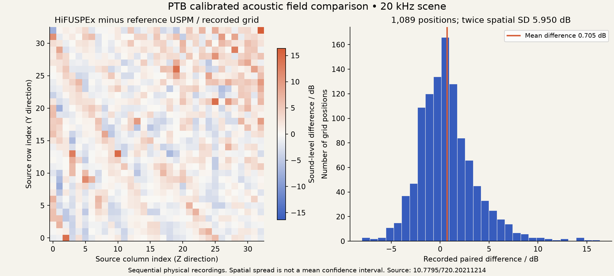

# What the recording-based release establishes

This release completes the no-equipment validation route with publicly available calibrated records and deliberately labeled simulations. It does not replace missing physical evidence with generated measurements. The Lab's Replay & validation workspace, CLI and standalone evidence packages expose the same recorded comparisons.

## Real source-calibrated acoustic reference

The PTB [HiFUSPEx dataset](https://doi.org/10.7795/720.20211214), by Cieslak, Kling and Wolff, contains genuine microphone recordings of physically reproduced industrial sound fields. These are measured laboratory recordings, even though the field scenarios are called simulated industrial environments. The retained CC BY subset includes nine unchanged source files, their CRC/SHA-256 provenance, microphone calibration tables, two raw ADC recordings and paired 33×33 sound-level maps.

For the 20 kHz, standing, left-ear, no-protection-grid scene, mean HiFUSPEx minus USPM reference level is **0.70509448 dB**. Twice the spatial sample standard deviation is **5.94958927 dB**. These reproduce the primary paper's rounded **0.71 / 5.95 dB** values over **1,089 source-matched grid positions**. Source calibration identifies pressure sensitivity with **0.6 dB expanded uncertainty, k=2**, for each microphone at 20 kHz. Source traceability and geometry are documented in [SOURCE.md](../data/calibrated-v2/hifuspex/SOURCE.md).



This is a genuine cross-instrument reference comparison of recorded calibrated levels. It is also a numerical reproduction using the authors' retained maps, rather than a new independent laboratory replication. The spatial spread is not a mean confidence interval. Cells are spatially correlated and scans were sequential. We do not divide spread by √1089 to claim a tightly known physical bias.

The raw WAVs show the intended approximately 20 kHz component on their nominal sample-rate axes. Complete electrical transfer gains/metadata and a sample-clock certificate are unavailable in this subset. Raw ADC units therefore remain raw units. We do not manufacture Pa, a calibrated absolute-frequency interval, precise per-cell physical coordinates, or complete raw-to-map regeneration. See [source integrity checks](../data/calibrated-v2/verify.py).

## An actual recorded follow-up, selected before revelation

The [stiffness replay](REPLAY_VALIDATION.md) selects only an actuator setting for which an unrevealed source record exists. Candidate force responses and the held-out unloading references never enter selection. The added response is then revealed and inference is updated. The measurement budget counts actual source observations, not invented device time.

Three initial observations → selected recorded point 5 → four-observation estimate. Held-out force RMSE changes **0.071856 → 0.040052 N**. A conventional endpoint protocol ties the selector. With all five available loading records, every protocol converges and reference RMSE becomes **0.041387 N**, slightly worse. The small reused dataset supplies no independent repeated-trial superiority claim.

The source reports calibrated independent force-reference hardware, but actuator position may include backlash. Only one initial residual degree of freedom is available. Broad Student-t intervals, an incremental F diagnostic, and explicitly assumed shared scale sensitivity retain that limitation. Full specimen stiffness accuracy is not certified.

## Generated signals and actual acquisition code

The [600-case acoustic study](../examples/acoustic-acceptance-v0.2/results.json) tests the production estimator. The declared nominal clock distribution gives **95/100 envelope coverage** (Wilson 95% interval approximately 88.8–97.8%). Fourfold unmodeled clock drift reduces coverage to **43/100**, although stationary-tone model checks still pass. This is a real limitation: a wrong clock cannot be identified from an otherwise stationary tone alone.

All 100 cases each of nearby tones, chirps, hard clipping and noise-only inputs were rejected as unreliable. These finite controlled distributions do not prove rejection of every possible bad recording or universal 95% measurement coverage.

The [18 acquisition checks](../examples/acquisition-acceptance-v0.2/results.json) use generated RGBA frames/tones and mocked asynchronous device APIs. They execute shared production transforms and actual Lab capture entrypoints. They cover known pixel displacement, marker loss/clipped crops, settling, mono/stereo preparation, duration/rate constraints and cancellation after permission, playback, context close/resume, decoding and resampling. They exposed six defects in v0.1.0 which are fixed here. The retained TAP transcript records each check.

## Explicitly unverified

| Claim | Evidence state |
|---|---|
| Public source-calibrated acoustic level comparison | Reproduced, with recorded reference instrument and source calibration scope |
| Recorded next-setting selection, revelation and held-out check | Executed on actual available source records |
| Acquisition arithmetic and cancellation invariants | Tested on generated media and mocked device APIs |
| Actual browser camera/microphone hardware, OS permissions, physical optics and room response | Not exercised on real devices |
| Browser resampler's actual anti-alias DSP quality | Adapter contract tested; physical/browser transfer not independently characterized |
| Independent total specimen stiffness uncertainty, full raw-WAV-to-Pa regeneration, calibrated sample clock | Not established by retained sources |
| Newly executed physical adaptive experiment or autonomous hardware actuation | Not performed or claimed |

The optional [physical acceptance protocol](PHYSICAL_VALIDATION.md) describes how a future contributor could extend those evidence states. Hardware is not required to reproduce this release's stated recording-based results. Social preview remains a manual repository setting because native file-dialog automation was denied; the image asset is supplied without claiming it was uploaded.

## Reproduce

```sh
python -m pip install -e '.[dev]'
python data/calibrated-v2/verify.py
instrumentzero replay --budget 4 --export replay.zip
instrumentzero validate-calibrated --export calibrated.zip
node --test tests/browser-acquisition.mjs
python scripts/validate_replay.py --output examples/my-replay
python scripts/validate_calibrated.py --output examples/my-ptb
python scripts/validate_acoustic.py --trials 100 --output examples/my-audio
python scripts/validate_acquisition.py --output examples/my-acquisition
```

Use fresh directories. Exact source and analysis hashes accompany the retained artifacts. Standalone ZIPs include executable code, raw or source-calibrated observations, required notices, numeric configuration and evidence limits. A repeated calculation does not create new physical observations.
