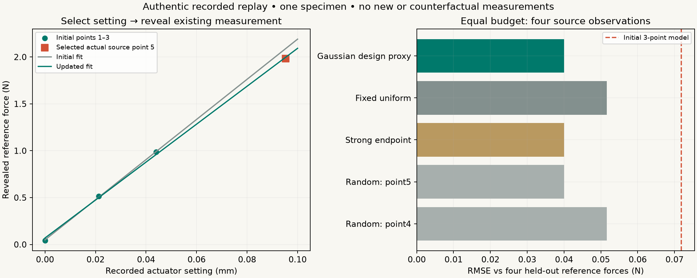

# An actual recorded follow-up, with no invented measurement

InstrumentZero can now run the complete **recorded** sequence: compile a bounded measurement question, inspect source calibration, infer from initial observations, choose an informative remaining recorded setting, reveal its authentic measured response, update the fit, check held-out reference forces, and export an executable package.

This is a replay of existing public calibrated-reference recordings. It does not perform new hardware experiments or synthesize an unrecorded outcome. The small source dataset supports a concrete working workflow and exposes limits; it does not establish general adaptive-design superiority.

## Run it

```python
from pathlib import Path
from instrumentzero.replay import recorded_stiffness_replay, export_replay_package

result = recorded_stiffness_replay(Path('data'), measurement_budget=4)
print(result['result']['quantity'])
print(result['reference_check'])
Path('recorded-replay.zip').write_bytes(export_replay_package(Path('data')))
```

```bash
python scripts/validate_replay.py --output examples/my-replay
python -m pytest tests/test_replay.py -q
```

Use a fresh output directory. The committed [replay.json](../examples/replay-validation/replay.json) retains every stage and revealed observation. [comparison.json](../examples/replay-validation/comparison.json) records source/code hashes, all policy results and their denominators. [recorded-replay.zip](../examples/replay-validation/recorded-replay.zip) contains the source CSV, attribution, configuration, replay result, pinned numerical dependencies, required engine source and `reproduce.py`. Extract it, install its requirements, and run `python reproduce.py` to recreate `reproduced-replay.json` without the repository checkout.

## Predeclared source and split

The source is Dera, Konopacka and Jarząbek's CC BY 4.0 [nickel force-microsensor dataset](https://data.mendeley.com/datasets/syjkdyzmxj/1), DOI **10.17632/syjkdyzmxj.1**. The original experiment reports a calibrated independent Megatron KM1403 reference-force transducer and a Thorlabs Z825B actuator. Source attribution and instrument details are retained with the data. See [VALIDATION.md](VALIDATION.md) for published-fit reproduction and the full loading/unloading check.

The recorded action is **actuator displacement in metres**. Its measured response is **reference force in newtons**. Future measured forces cannot be used as candidate settings: that would reveal the response before selecting it.

Before inspecting future responses, this protocol fixes an actuator-displacement window of **0–0.1 mm**. It contains loading source points **1–5** and unloading points **12–15**. The first three loading points are the initial calibration/design observations. The only remaining candidate settings are point 4 at **0.06966 mm** and point 5 at **0.09530 mm**. Four unloading records are held out from both selection and fitting. No new force or displacement value is generated.

This displacement window is an archive selection rule, not a validated safe operating limit for another specimen. The paper reports instability above roughly 3 N. Historical source data do not authorize new physical loading.

## What the compiler and calibration stage actually do

The bounded compiler states the force-on-actuator-displacement model:

```
reference_force_N = offset_N + stiffness_N_per_m * actuator_displacement_m
```

Distinct initial settings identify the statistical slope and offset. They do not independently verify true specimen deflection or full physical uncertainty.

The initial three source observations yield a residual-scale proxy of **0.015890 N** with only **one residual degree of freedom**. It is frozen before selection. This is linear-fit scatter across settings, not a repeated-measurement noise calibration. It can contain model error, actuator backlash and reference noise. No source noise certificate is invented.

Shared **1% length** and **0.5% force** scale sensitivities are explicit example assumptions, consistent with the ordinary recorded example. They are not source-certified uncertainties. They are propagated once per complete fit, rather than once per observation, so extra records cannot average them away. If corrected force is recorded force times `f`, and corrected displacement is recorded displacement times `l`, corrected stiffness is fitted stiffness times `f/l`.

Conditional statistical intervals use Student-t slope draws with the initial scale estimate's **one degree of freedom**, combined with those shared scale corrections. The intervals are deliberately broad and remain conditional on a linear, independent Gaussian response model. They are not a certificate of total physical accuracy.

## Selecting and revealing the next record

The selector sees only a plug-in Gaussian design proxy and unrevealed actuator-setting metadata. For design vector `h=[1, displacement_m]`, finite **known-noise Gaussian proxy** matrix `C`, and initial residual variance proxy `R`, its Gaussian stiffness-variance reduction score is

```
reduction = (C[stiffness,:] @ h)^2 / (R + h.T @ C @ h)
```

Every candidate costs **one recorded observation**. Acquisition seconds are unavailable and are not invented. Joint-information and target-stiffness information scores are explicitly exported as **Gaussian design proxies**. The shared sensitivity floor is retained in the fractional proxy score.

The inference interval uses Student-t with one degree of freedom, which has **infinite variance**. The finite design matrix and Gaussian scores are not the covariance or mutual information of that Student-t distribution. They are a computational design heuristic conditional on plugging in the initial noise scale. This distinction changes the interpretation, not the selected setting on this small pool.

The default selector chooses **actual source point 5**, then reveals its recorded reference response **1.982 N** at **0.09530 mm**. The measured response is accessed by the selection path only after selection. The three-point conditional stiffness estimate changes from **21,419.30 N/m** to **20,234.52 N/m**. The updated conditional interval is approximately **17.4–23.2 kN/m**, not a full accuracy claim.

Only after all selections finish does the replay expose the four held-out unloading forces for reference checking. Their prediction RMSE changes from **0.071856 N** initially to **0.040052 N** after the selected actual record. The reference hardware is separate from the microsensor, while specimen, source setup and actuator remain shared.



## Fair comparisons, including the negative results

All four-observation protocols receive the same three initial records and may reveal exactly one of the same two remaining loading records. The chronological fixed/uniform protocol takes point 4. A strong predeclared endpoint protocol takes the furthest remaining actuator setting, point 5. The random baseline enumerates both possible next records, each with probability one half.

| Protocol | Selected source record | Held-out reference-force RMSE |
|---|---:|---:|
| Initial three records | None | 0.071856 N |
| Gaussian design proxy | 5 | 0.040052 N |
| Fixed/uniform source order | 4 | 0.051614 N |
| Strong endpoint | 5 | 0.040052 N |
| Random choice, both possibilities | 4 or 5 | Mean 0.045833 N |

The covariance method ties the strong endpoint method. It does not outperform sound domain-specific design here. This is **one source specimen/experiment**, five eligible loading records and four held-out unloading records. The two random outcomes are an exhaustive ordering denominator of **two**, not independent physical trials, and do not justify significance tests or broad accuracy claims.

With a budget of five, every policy reveals both remaining loading observations and converges to the same estimate and **0.041387 N** held-out RMSE. That is slightly worse than the four-observation endpoint result. Another observation can reduce a Gaussian design-proxy variance while worsening actual held-out model error. The result is retained rather than hidden.

## Model error and evidence limits

The incremental model diagnostic respects the tiny initial variance estimate. If `SSE_initial` is the initial one-degree-of-freedom residual sum of squares and `SSE_full` includes `n` observations, the orthogonal increment statistic is

```
((SSE_full - SSE_initial) / (n - 3)) / SSE_initial  ~  F(n - 3, 1)
```

This holds under the stated independent Gaussian linear model and outcome-independent setting selection. It is unassessed at the initial three observations and has very low power with one denominator degree of freedom. A failure to reject is not model validation. No known-noise chi-square accuracy claim is made.

The selector depends on accumulated design information, not unexpected outcome values. It does not discover new physical models or validate unrecorded actions. The ordinary product's displacement-on-force analysis can still reject linearity under its declared 1 μm noise sensitivity; this separate force-on-displacement replay does not override that result.

No complete reference calibration certificate, independent specimen-deflection measurement or total systematic-uncertainty budget is supplied. Source actuator readings may include slack/backlash. Loading/unloading disagreement remains genuine model error. The top-level result therefore keeps **`physical_accuracy_verified: false`** and a conditional status. Replayed calibrated-reference evidence completes the executable archive workflow; it does not become a newly executed live experiment.

The [5,400-trial synthetic design study](RESEARCH.md) supplies separate controlled comparisons and misspecification tests. Its simulated observations are never merged into this recorded replay.
