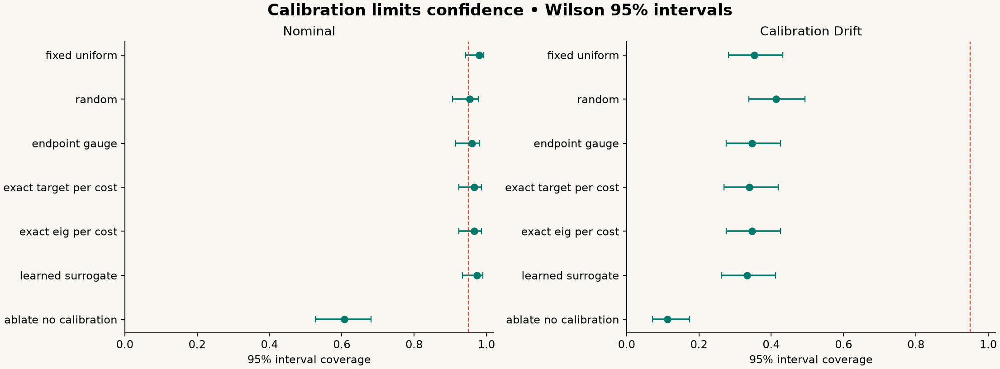

# Does adaptive measurement design buy accuracy?

InstrumentZero v0.1 includes a reproducible controlled study, not a claim of a new general-purpose scientific intelligence. Under the specified linear model, cost-aware designs estimate stiffness more accurately than a uniform video protocol. A strong fixed endpoint protocol nearly matches them. The learned surrogate adds no demonstrated practical benefit over the exact classical calculation, so the exact method is the default.

The same evaluation exposes serious failures: ignoring shared calibration creates overconfident intervals; unmodeled calibration drift breaks nominal coverage; all policies fail when a nonlinear spring is analyzed as linear. These are limits of the scientific assumptions, not successful discoveries.

**All data in this benchmark are simulated.** Measured-recording validation elsewhere in this repository is a separate evidence class. No synthetic trial represents a live physical experiment.

## Reproduce

From a clean checkout with Python 3.11 or newer:

```bash
python -m venv .venv
source .venv/bin/activate
python -m pip install -e '.[dev]'
python scripts/benchmark.py --trials 150 --training-states 1500 --output benchmarks/my-run
python -m pytest tests/test_design.py -q
```

Use a fresh output directory: the script refuses to replace an earlier run. Numerical results are deterministic for the recorded seeds; wall-clock times depend on the machine. The committed release run is [benchmarks/release-0.1.0](../benchmarks/release-0.1.0/). Its `results.json` records configuration, dependency versions, source hashes, training diagnostics and summaries. `trials.csv` retains every trial, including action counts, costs, reference truth, estimates and coverage. `surrogate.npz` contains only numeric arrays, loaded without pickle. PNG/SVG figures derive directly from results.

The initial development run is preserved outside the repository task folder. The release run is the authoritative artifact for this report.

## Model and what is identifiable

The quantity of interest is stiffness `k` in N/m. Compliance `c = 1/k` is measured in m/N. The displacement model is

```
y = b + c F + delta_sensor F + epsilon
```

`b` is the zero offset, `F` is known force in N, and `epsilon` is independent Gaussian displacement noise. `delta_sensor` is one shared calibration slope offset per modality, constant throughout a trial. It cannot be averaged away by taking repeated observations on the same sensor.

The Gaussian state is `(b, c, delta_video, delta_gauge)`. Priors are independent with means `(0, .001, 0, 0)` and standard deviations `(1 mm, .7 mm/N, .03 mm/N, .008 mm/N)`. The inference retains both calibration nuisances. With one sensor, only `c + delta_sensor` is identified by its observations; the calibration prior limits physical compliance precision. Without a physical calibration constraint, stiffness is not identified. Likewise, one force alone cannot identify an unknown zero offset and compliance.

The simulator samples true compliance uniformly from `.0005` to `.002 m/N` (500–2000 N/m), zero offset from the stated prior, and calibration offsets from the stated Gaussian distributions. The compliance prior is intentionally broader than that test range. It is not a learned prior fit to test truth.

Posterior means and covariances use the exact linear-Gaussian rank-one update. A 95% compliance interval is transformed by reciprocal endpoints into an asymmetric stiffness interval. Intervals crossing zero are counted as unbounded; nonpositive point estimates are counted as failures. Neither condition is silently dropped from coverage or failure reporting. RMSE summaries use finite positive estimates and separately report any failures. This run had no failed estimates or unbounded intervals.

## Actions, sensors and budgets

Every policy can choose forces `{0,1,2,3,4,5} N` through either modality:

| Modality | Independent displacement noise | Acquisition cost | Shared calibration uncertainty |
|---|---:|---:|---:|
| Video | 80 μm standard deviation | 1 second | 30 μm/N |
| Gauge | 20 μm standard deviation | 4 seconds | 8 μm/N |

These are declared simulation assumptions, not measured device specifications. Acquisition costs include no setup or switching overhead. Each policy receives the same 24-second acquisition budget and cannot overspend. All completed release trials spent exactly 24 seconds. This compares equal costs, not equal sample counts.

Four regimes test different assumptions:

1. **Nominal:** the stated linear model and noise/calibration assumptions hold.
2. **Heteroscedastic:** video noise increases by `1+(F/3)^2`; gauge noise is constant. Policies receive this calibrated noise function. They never see actual future noise realizations.
3. **Calibration drift:** true shared calibration offsets have four times their stated standard deviations. Inference still assumes the nominal calibration uncertainty. This deliberately tests undetected miscalibration.
4. **Nonlinear:** add `a F²` with `a = ±40 μm/N²`, random sign per trial. Inference still fits the linear model. The target is zero-load tangent stiffness `1/c`; the fitted global linear slope is systematically inappropriate.

## Policies and ablations

- **Fixed uniform:** cycle through all six video loads.
- **Random:** select uniformly among all affordable actions, including both modalities.
- **Endpoint video:** alternate 0 and 5 N using video.
- **Endpoint gauge:** alternate 0 and 5 N using the precise gauge. This strong domain-specific baseline avoids comparison only against weak schedules.
- **Exact target per cost:** maximize expected fractional reduction of marginal compliance variance divided by acquisition seconds.
- **Exact EIG per cost:** maximize joint Gaussian expected information gain about the whole state per second.
- **Learned surrogate:** select using a small regressor trained to approximate exact target acquisition.
- **No-cost ablation:** maximize target variance reduction without the cost divisor; still respect the same budget.
- **No-calibration ablation:** use target/cost selection and inference while fixing calibration nuisance variances to zero.

For design vector `h`, covariance `C`, and independent observation variance `R`,

```
C_new = C - (C h)(C h)^T / (R + h^T C h)
target_gain = (C[c,c] - C_new[c,c]) / C[c,c]
joint_EIG = 0.5 log(1 + h^T C h / R)
```

The target and joint-information objectives differ. Estimating an instrument's nuisance offset can improve joint information without optimally improving stiffness precision.

**Adaptivity boundary:** in a known linear-Gaussian model, posterior covariance depends on selected actions and calibrated noise, not observed displacement values. These policies adapt to remaining budget, sensor context and accumulated design information. They do not react to unexpected measured outcomes. Claims of outcome-adaptive model discovery, nonlinear robustness or autonomous scientific reasoning would exceed this experiment.

## Learned component

A compact random-feature ridge model has seven observable inputs: log marginal compliance variance, log predictive variance, log compliance–observation cross-covariance magnitude, log sensor-noise variance, log acquisition cost, force and modality indicator. Sixty-four fixed random tanh features plus standardized raw features and a constant feed 72 trained output weights. The target is log exact target gain per cost.

Training uses 1,500 independent simulated posterior states and 18,000 candidate-action examples. Random action histories and prior scales vary during training. Seed `7123` is used for training; `88123` generates 200 validation states. Test trials start at seed `100000`; no test state or test truth is used to train or select hyperparameters. The release validation action agreement is 90%, with log-score RMSE about 0.097. The complete training and validation cost is recorded.

This is supervised acquisition distillation, not reinforcement learning or a new Bayesian-design algorithm. The exact teacher is already cheap. In this benchmark the surrogate costs more computation and does not establish a meaningful accuracy advantage. A promising future question is whether learning becomes useful for expensive nonlinear forward models or finite-horizon design with setup costs; neither was tested here.

## Controlled comparison and uncertainty

There are 150 paired trials per policy per regime: 5,400 trials total. A trial shares physical truth across policies. Measurement randomness is keyed by trial, regime, action and repeat number, so matching repeated actions receive matching fresh draws across policies. Different repeats are independent; observations are not permanently cached per action.

Reported measures include stiffness relative RMSE, mean absolute relative error, 95% interval coverage and width, target information, sample count, gauge sample count, actual cost, failures, and selection computation. Timing includes the policy's validation and scoring overhead and excludes physical acquisition time. It is a local diagnostic, not a stable cross-machine speed claim.

Coverage receives Wilson 95% intervals. Mean absolute relative-error differences receive 2,000 paired bootstrap resamples against uniform, endpoint gauge and exact target/cost baselines. These are exploratory comparisons without multiple-comparison correction. Point-estimate rankings alone do not establish superiority.

## Release results

The following table rounds the authoritative JSON results. Relative RMSE is a percentage of true stiffness. Coverage is the fraction of true stiffness values inside the nominal 95% interval.

| Policy | Nominal RMSE | Nominal coverage | Heteroscedastic RMSE | Drift RMSE | Drift coverage | Nonlinear RMSE |
|---|---:|---:|---:|---:|---:|---:|
| Fixed uniform video | 3.09% | 98.0% | 3.36% | 13.72% | 35.3% | 23.57% |
| Random feasible action | 1.10% | 95.3% | 1.09% | 3.15% | 41.3% | 24.76% |
| Endpoint video | 3.02% | 97.3% | 3.49% | 13.62% | 33.3% | 23.84% |
| Endpoint gauge | 0.94% | 96.0% | 0.86% | 2.99% | 34.7% | 23.96% |
| Exact target/cost | 0.89% | 96.7% | 0.80% | 2.97% | 34.0% | 23.82% |
| Exact EIG/cost | 0.88% | 96.7% | 0.80% | 2.98% | 34.7% | 23.81% |
| Learned surrogate | 0.88% | 97.3% | 0.80% | 2.96% | 33.3% | 23.84% |
| No-cost ablation | 0.87% | 96.0% | 0.86% | 2.98% | 32.7% | 23.85% |
| No-calibration ablation | 0.88% | 60.7% | 0.82% | 3.10% | 11.3% | 23.77% |




The cost-aware method beats the uniform video procedure in this model largely by allocating budget to a more precise, better-calibrated modality. A fixed gauge endpoint design captures most of that advantage. This does not establish a general benefit of AI over careful experimental design.

Against endpoint gauge, the nominal paired mean absolute relative-error difference for exact target/cost is −0.010 percentage points (bootstrap 95% interval −0.059 to +0.041 points), which includes no difference. In the heteroscedastic regime the difference is −0.045 points (−0.088 to −0.004). These are small effects beside the advantage of choosing the well-calibrated gauge at all. The learned surrogate's nominal difference from exact is approximately −0.010 points; its exploratory interval barely excludes zero, other regimes do not support a consistent benefit, and it is computationally slower. This is insufficient reason to replace the exact formula. Training and validation took about 1.22 seconds in the release run.

The no-calibration ablation attains a plausible point estimate while severely understating uncertainty. Unmodeled drift destroys coverage even when the planner includes nominal calibration uncertainty. All nonlinear intervals miss the true tangent stiffness. Better action selection does not rescue a wrong forward model; product workflows must inspect residuals and reject unreliable conclusions.

## What this study does not establish

It does not measure real hardware throughput, calibrate a physical camera/gauge, validate arbitrary scientific questions, establish learned-policy advantages, demonstrate robustness to unknown nonlinear physics, or establish real experimental efficiency gains. Recorded sensor validation checks supported inference on authentic data, while this simulator supplies exhaustive controlled comparisons. Neither replaces a supervised physical experiment with independently calibrated reference equipment.

## Foundations and attribution

- Klimesch et al., [Designing physics experiments with artificial intelligence](https://www.nature.com/articles/s41586-026-10898-6), Nature 657, 47–58 (2026), DOI 10.1038/s41586-026-10898-6. The accessible abstract guided the separation of search space, simulator, objective and search; full text was not available during this build.
- Foster et al., [Deep Adaptive Design: Amortizing Sequential Bayesian Experimental Design](https://arxiv.org/abs/2103.02438), ICML 2021. Learned sequential design policies predate InstrumentZero; our small surrogate is not an implementation of DAD.
- Barlas, Sloman and Kaski, [Robust Experimental Design via Generalised Bayesian Inference](https://arxiv.org/abs/2511.07671), v2, October 2026. Motivation for explicit noise/model-misspecification tests; its acquisition method is not implemented here.
- Tang, Sloman and Kaski, [Representative, Informative, and De-Amplifying](https://arxiv.org/abs/2506.07805), AISTATS 2026. Informativeness under a wrong model is not sufficient for predictive correctness.
- [SciPy](https://scipy.org/) and [NumPy](https://numpy.org/) provide scientific computation. [BoTorch](https://github.com/meta-pytorch/botorch) supplies a broader Bayesian-optimization route for future expensive models, but is not required or used in this analytical benchmark.
- [Bluesky](https://github.com/bluesky/bluesky), [Bluesky Adaptive](https://github.com/bluesky/bluesky-adaptive), [PyVISA](https://github.com/pyvisa/pyvisa), [PyMeasure](https://github.com/pymeasure/pymeasure), and [Phyphox](https://phyphox.org/) informed adapter boundaries. Optional integrations must be tested against their actual versions and instruments; their existence does not establish a working connection.
