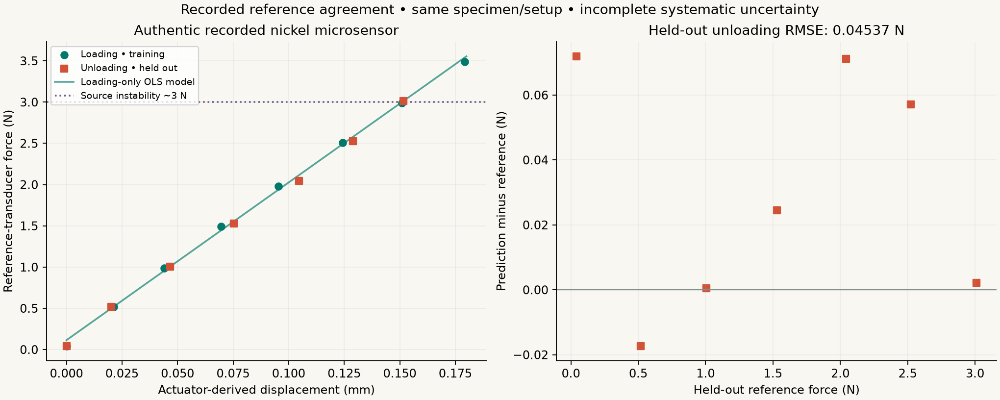
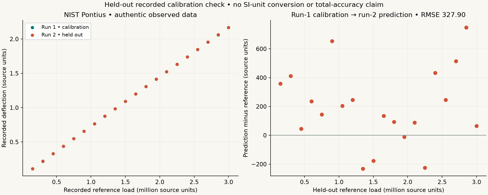

# Checks against authentic recorded reference data

InstrumentZero reproduces published numerical fits and predicts held-out recorded reference observations. These checks use authentic source experiments and retain the distinction between independent reference hardware, independent held-out observations, and fully independent physical truth. **No new live experiment was run.**

The nickel-sensor source reports a calibrated independent force transducer. Loading-only calibration predicts seven held-out unloading reference-force observations with **0.04537 N RMSE**. A second check calibrates a NIST load-cell response on one run and predicts recorded reference loads in another with **327.899 source units RMSE**, or **0.01093% of full scale**. Neither result establishes traceable total measurement accuracy, because complete calibration certificates and systematic-uncertainty budgets are unavailable.

## Reproduce and inspect the evidence

```bash
python scripts/validate_real.py --output examples/my-validation
python -m pytest tests/test_validation.py -q
```

Use a fresh output directory. The script preserves existing outputs instead of overwriting them. The committed [results.json](../examples/validation/results.json) records script/source SHA-256 hashes and dependency versions. Predictions are retained point by point in [nickel_predictions.csv](../examples/validation/nickel_predictions.csv) and [pontius_predictions.csv](../examples/validation/pontius_predictions.csv). The script uses source CSV files directly and makes no network or hardware requests. Plot files are generated from those same predictions.

The tests check the published numerical certificate, source-file integrity, inversion limits, and a substantive independence invariant: changing held-out observations must not change the fitted training model.

## Nickel microsensor: physical reference and held-out branch

Dera, Konopacka and Jarząbek's [dataset](https://data.mendeley.com/datasets/syjkdyzmxj/1), DOI **10.17632/syjkdyzmxj.1**, accompanies their [Precision Engineering article](https://doi.org/10.1016/j.precisioneng.2025.05.003). It provides 15 force/displacement pairs: eight loading points followed by seven unloading points. The authors report a calibrated Megatron Elektronik KM1403 force-reference transducer and Thorlabs Z825B motorized displacement actuator. The retained data and article are CC BY 4.0; see [attribution](../data/nickel-sensor/CC-BY-NOTICE.txt) and [source instrument notes](../data/nickel-sensor/README-source.txt).

### Published numerical reproduction

Fit force as a function of actuator-derived displacement using ordinary least squares:

```
force_N = intercept_N + stiffness_N_per_m * displacement_m
```

All 15 source observations give:

| Quantity | Recomputed | Published Eq. 8 |
|---|---:|---:|
| Stiffness | 19,125.915 N/m | 19,126 N/m |
| Force offset | 0.0994024 N | 0.0994 N |
| Conditional slope standard error | 200.146 N/m | 200.1 N/m |
| R² | 0.9985784 | 0.9986 |

The source's equation is on PDF page 7, journal page 257, of [article-source.pdf](../data/nickel-sensor/article-source.pdf). The 0.08466 N/m difference in the slope is consistent with the publication's rounding. The recomputed conditional 95% slope interval is **18,693.5–19,558.3 N/m**. It treats displacement values as exact and accounts only for regression scatter. It excludes missing actuator/reference systematic uncertainty.

This is numerical reproduction using the same curve as the paper. The agreement does **not** provide independent physical stiffness truth or validate a new instrument.

### Predicting reference force in a held-out branch

Use only the eight loading observations to fit the force-on-displacement model. The seven unloading observations remain excluded from fitting and are used once for prediction evaluation. The loading model has slope **19,119.34 N/m** and offset **0.113932 N**.

| Held-out unloading metric | Result |
|---|---:|
| Observations | 7 |
| Reference-force prediction RMSE | 0.0453666 N |
| Mean prediction minus reference | +0.0299968 N |
| Maximum absolute error | 0.0719322 N |
| RMSE / maximum recorded source force, 3.488 N | 1.30065% |



The force measurements originate from reference hardware distinct from the microsensor. The held-out branch is genuinely excluded from training. However, both branches share the specimen, source setup, displacement actuator and potential systematic errors. “Held out” does not mean independent laboratory validation. The source supplies no complete calibration certificate or total uncertainty budget. The modest branch sample size and loading/unloading sequence do not establish broad hysteresis or repeatability guarantees.

The article reports instability and out-of-plane rib deflection above approximately **3 N**. Historical recorded points above that threshold remain part of the numerical reproduction; they do not authorize new physical loading. The actuator may have slack or backlash, and its position cannot be assumed to equal independently measured specimen deflection without uncertainty.

### Why the product example may reject a linear stiffness result

The product's conservative recorded example limits source observations to **at most 2.5 N**, analyzes **displacement as a function of force**, and applies explicitly stated assumed sensor uncertainty. It can reject linear-model adequacy under those assumptions. This validation report instead reproduces the paper's **force-on-displacement** regression over all 15 source points and checks a loading-to-unloading prediction. Different regression directions, point subsets and uncertainty assumptions answer different questions. A close published slope reproduction does not override a product model-adequacy rejection or establish that either direction's uncertainty is a complete physical error budget.

## NIST Pontius: held-out calibration run

The [NIST/ITL Pontius dataset](https://www.itl.nist.gov/div898/strd/lls/data/Pontius.shtml) contains 40 observed calibration points in two increasing-load runs. Its [certified regression values](https://www.itl.nist.gov/div898/strd/lls/data/LINKS/v-Pontius.shtml) specify a quadratic deflection response. The retained raw source is [Pontius.dat](../data/Pontius.dat), with [NIST terms and acknowledgment](../data/NIST-NOTICE.txt).

The source does not specify usable SI conversion factors. All values below remain in **original source units**. They must not be labeled as newtons, metres or stiffness in N/m.

First, fitting all 40 observations reproduces the published quadratic coefficients to better than `1e-10` relative numerical tolerance. This checks the numerical fitting implementation against a separately published certificate. It is not an independent physical accuracy certificate.

For the held-out check, fit the forward quadratic to **run 1 only** (20 observations), then invert it at each **run 2** deflection and compare against that observation's recorded known load. Loads are scaled internally during fitting to avoid poor numerical conditioning; coefficients and predictions are returned in source units. Inversion requires the polynomial to be strictly increasing throughout its declared interval and rejects out-of-range values.

| Held-out run-2 metric | Result |
|---|---:|
| Observations | 20 |
| Predicted-load RMSE | 327.898789 source units |
| Mean prediction minus reference | +198.785080 source units |
| Maximum absolute error | 748.205075 source units |
| Full-scale reference load | 3,000,000 source units |
| RMSE / full scale | 0.01092996% |



Run 2's measurements are excluded from the calibration fit, but both runs share the source apparatus and may share systematic errors. Two monotone runs confound drift with load. The error is conditional agreement with the retained reference loads, not a new estimate of physical stiffness accuracy or long-term stability.

## Evidence boundary

These checks establish executable numerical reproduction and prediction against held-out authentic reference observations. The nickel dataset additionally identifies independently calibrated reference-force hardware in the original experiment. They do not establish a newly executed live experiment, an independent stiffness certificate, traceable full-system accuracy, physical success of an unperformed recommended action, or adaptive-design efficiency on real hardware. Synthetic design benchmarks remain separate in [RESEARCH.md](RESEARCH.md).
