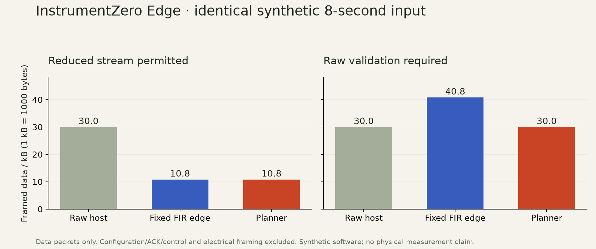

# Edge v0.3.0-rc.2: runtime configuration evidence

This is a software preview. Runtime device configuration is implemented and tested in software, and the complete adapter cross-compiles. No sensor has been operated or flashed. Physical acquisition, real reconfiguration/unplug behavior and independent measurement remain unverified.

## Executed checks

The full local Python suite passed 170 tests. The browser logic suite passed 30 tests. The shared numerical core passed its C99 AddressSanitizer/UndefinedBehaviorSanitizer harness, C++17 integration caller and actual Cortex-M4 object compilation. The separate C11 control parser, lifecycle guard and receive ring passed sanitizer execution and actual Cortex-M4 object compilation.

Control tests cover Python/C byte agreement, CRC-valid unsupported fields, truncation, signed calibration, all placements, partial serial writes, stale/wrong/corrupt acknowledgements, disconnects, no-start-on-failure, same-port configuration changes, epoch exhaustion, receive-ring bursts/wrap/overflow, offline CLI generation, and cancellation after acknowledgement but before start. Import validation rejects a missing acknowledged transformed stream. Source-complete API exports retain control receipts and recompute them against the original data. An independent reviewer executed these corrected paths using disposable synthetic fixtures, without a device.

Review found and corrected polling RX loss, a receive ring smaller than a complete maximum request, a pre-start cancellation gap, malformed receipt handling and weaker receipt retention through the Python export API. These were defects found before this release, not hardware observations.

## Complete firmware builds

[Source-bound build receipts](../../examples/edge/firmware-runtime-build/report.json) retain linked image hashes, configuration and compiler stack reports. All three binding builds succeeded with Zephyr 4.2.0 and SDK 0.17.2. Every image contains the same runtime-capable paths and accepts raw-host, calibrated-edge and filtered-edge configurations within its compiled block/queue envelope. These are not three hardware performance measurements.

| Build configuration | Linked flash | Linked RAM |
|---|---:|---:|
| Raw-host binding | 33,036 B | 25,920 B |
| Calibrated-edge binding | 33,036 B | 25,920 B |
| Filtered-edge binding | 33,036 B | 25,920 B |

The current example declares a 40,960-byte total planning budget, with a 16,384-byte RTOS/driver/stack reserve, explicit 6,144-byte configuration/receive reserve, bounded queues/workspaces and a processing state allocated in every runtime mode. The 2,048-byte interrupt-driven RX ring holds a complete maximum configuration request while the preceding data block finishes transmission. Overflow poisons the stream and ends acquisition. A new clean device session is required.

Compiler reports showed a 2,672-byte main frame and a 1,160-byte decoder frame, prompting an increase of the configured main stack from 4,096 to 6,144 bytes. Function-frame reports are not runtime stack high-water measurements or exhaustive call-chain proofs. Linker RAM and modeled reserves are distinct quantities. Device timing, processing utilization, IRQ losses, power and actual maximum stack use remain unmeasured.

## Fresh frozen synthetic confirmation

The [rc2 plan](../../examples/edge/confirmation-plan-rc2.json) was committed before running fresh disjoint seeds 9131101 and 9131102. It binds source, rules, specifications, measured host cost profiles and unchanged numerical acceptance thresholds. The unchanged numerical core allows reuse of its existing measured-host cost profiles; these remain MCU proxies.

All [18 current cases](../../examples/edge/confirmation-rc2/results.json) passed, including unsuitable signals and graphs favoring the host. Across eight accepted synthetic trials, the maximum frequency error against the known model was 0.00001752 Hz and maximum relative damping error was 0.0001519. These numerical checks are not independently acquired physical measurements.



| Synthetic eight-second data stream | Raw host | Fixed FIR edge | Planner |
|---|---:|---:|---:|
| Reduction permitted | 30,000 B | 10,800 B | 10,800 B |
| Raw validation required | 30,000 B | 40,800 B | 30,000 B |

The planner ties the sensible fixed-edge baseline when reduction is appropriate. These counts include data-frame prefixes, headers, timestamps and CRCs. They exclude configuration/ACK/control traffic and UART/USB electrical framing. The capture sidecar separately records actual host control bytes and received control/prior bytes, plus host startup/read/flush durations. No physical acquisition-to-result latency or total electrical-transfer measurement is claimed.

The earlier [rc1 evidence](VALIDATION.md) and confirmation files remain preserved as version-specific history.

## Reproduce and use

```sh
python -m pytest -q
node --test tests/browser-acquisition.mjs tests/browser-validation.mjs tests/browser-edge.mjs
python scripts/verify_edge_core.py --output NEW_NUMERICAL_CHECK_FOLDER
python scripts/verify_edge_control.py --output NEW_CONTROL_CHECK_FOLDER
python scripts/validate_edge.py --output NEW_CONFIRMATION_FOLDER
python scripts/summarize_edge.py --output NEW_FIGURE_FOLDER
instrumentzero edge control examples/edge/adxl345-spec.json --output NEW_REQUEST.izc
```

The last command generates bytes offline; it never opens a device. [CONTROL.md](CONTROL.md) describes the checked stop/configure/ack/start protocol. [FIRMWARE.md](FIRMWARE.md) describes building only. Actual physical work requires equipment inspection and the acceptance checks in [PHYSICAL.md](PHYSICAL.md). The original instrument objective remains open until those gates pass.

Release-specific remote CI, downloaded-asset checks and independent installation receipts are recorded with the versioned public prerelease. The table above reports the local checks and builds, rather than inferring success from a CI badge.
