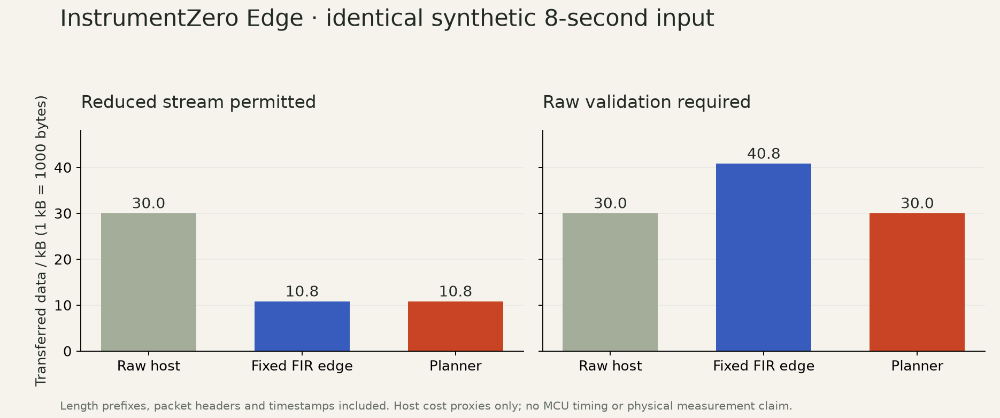

# Edge v0.3.0-rc.1: executed evidence and open gates

Status: **software preview**. The software checks below were executed locally; the versioned release also records remote CI and downloaded-artifact verification. **Acquisition and independent physical measurement remain unverified.** No physical sensor was activated or device flashed for this work.

## Executed software checks

- Current Python suite: 138 tests, including the original recording workflows and Edge compiler, independent float64 numerical references, arbitrary chunks/resets, short buffers, protocol corruption/drop/repeat/reorder, epochs, clock faults, clipping, queue overflow, imported device transforms and cancelled serial cleanup. The serial cancellation fixture is simulated; it does not exercise a physical port.
- Browser logic: 30 Node tests across the original Lab and Edge. Seven Edge regressions cover stale results/exports, unapplied JSON, late requests and delayed initial configuration. Browser inspection and the walkthrough use an independently installed wheel. The IAB download-event observer timed out; the exact selected export URL was fetched and recomputed directly. HTTP export is tested; native browser file-save behavior is not claimed verified.
- C99 numerical core: an executed AddressSanitizer/UndefinedBehaviorSanitizer harness and an actual freestanding Cortex-M4 object cross-compilation, and a C++17 caller linked to the separately compiled C99 core and executed. No heap or hidden clock/I/O exists in the core.
- Full Zephyr 4.2.0 / SDK 0.17.2 builds of all three provisional placements. Build receipts bind adapter source files, configuration, core and linked images. No flashing was performed.
- A fresh Python environment installed the wheel and locked dependencies without private caches. Changed-input execution and a source-complete exported package recomputed from a separate directory using the included source and a local compiler.

Commands are reproducible from the checkout:

```sh
python -m pytest -q
node --test tests/browser-acquisition.mjs tests/browser-validation.mjs tests/browser-edge.mjs
python -m ruff check src tests scripts data/reproduce.py
python scripts/verify_edge_core.py --output NEW_CORE_CHECK_FOLDER
python scripts/validate_edge.py --output NEW_CONFIRMATION_FOLDER
python scripts/summarize_edge.py
```

The firmware build command and pinned prerequisites are in [FIRMWARE.md](FIRMWARE.md). [Build receipts](../../examples/edge/firmware-build/report.json) include compiler section and stack-allocation reports. Those reports do not measure stack high-water, processing utilization or physical timing.

| Placement | Linked flash bytes | Linked RAM bytes |
|---|---:|---:|
| Raw host | 28,552 | 14,400 |
| Calibrated edge | 30,592 | 18,560 |
| Filtered edge | 31,164 | 18,560 |

The declared total memory budget is 32,768 bytes, including an explicit conservative 16,384-byte fixed RTOS/driver/stack reserve plus bounded processing and transport allocations. Linker RAM is a separate observed build result. Runtime maximum stack usage remains unmeasured.

## Frozen synthetic confirmation

The first 18-case run is retained under `confirmation-v0.3` as **superseded**, because independent review corrected memory accounting, imported edge evidence, serial lifecycle and generated binding identity. No result from that earlier contract is promoted as final acceptance.

The reviewed [confirmation plan](../../examples/edge/confirmation-plan.json) froze rules, measured host cost profiles, source hashes and a new disjoint seed set before the [current 18 cases](../../examples/edge/confirmation-final-v0.3/results.json). It includes two mounting models, silence, a chirp, close modes, saturation, an impulse and graphs that favor the host. Exact raw generated samples and every result/rejection are retained. All 18 cases meet the predeclared software criteria. These are new synthetic cases, not held-out physical remounts.



| Eight-second synthetic input | Raw host | Fixed FIR edge | Planner |
|---|---:|---:|---:|
| Reduced stream permitted | 30,000 B | 10,800 B | 10,800 B |
| Raw validation required | 30,000 B | 40,800 B | 30,000 B |

Length prefixes, headers, CRCs and timestamp offsets are included. The planner **ties the sensible fixed-edge baseline** when reduction is appropriate. When raw validation is required it keeps processing on the host, avoiding the extra reduced stream. It does not claim a universal improvement over fixed placement. Measured host costs are provisional MCU proxies; data-path comparisons do not measure MCU speed, power, device timing or total acquisition-to-result latency.

Full numeric errors and per-run host wall times are in [summary.json](../../examples/edge/confirmation-final-v0.3/summary.json) and retained trial files. Frequency/damping compare both known synthetic model values and a separately implemented float64 calculation of the same samples. That calculation is an independent numerical reference, not an independently acquired physical measurement. Host timings vary with load and are not presented as a hard real-time guarantee.

## Independent review and failures retained

Review found concrete defects before release: unsafe pointer-vector shapes, queue/profile resource validation, prefix/dual-stream byte accounting, integer rates, audio clipping scale, 32-bit arithmetic guards, damping identification consistency, callback stop/reset synchronization, imported device-output validation, serial cleanup and UI races. Focused regressions cover the corrected paths. The reviewer independently reproduced the discarded-device-output and disposable-file cleanup failures, then checked their fixes. No actual device or unrelated user data was used in those reproductions.

Earlier failed imports/builds and superseded confirmations remain task-local. The first full firmware attempt failed to link because its random-generator configuration was missing; later builds enable the reviewed generator. Negative trials remain negative, including clipping and model rejection.

## Open physical gates and material limits

The adapter is a provisional reference-board implementation. Its timestamp is a driver-thread callback before sample fetch, not the physical sampling aperture. Sensor loading, mounting, pre-digital aliasing, masked/hidden IRQ losses, clock drift/rollover, real unplug/cancel, device/browser gain and resampling, host-device clock mapping, total latency, power, utilization and memory high-water are unmeasured. Hardware configuration currently uses a newly compiled binding; runtime firmware graph reconfiguration is not implemented or demonstrated.

No physical setup is available for fresh remounts and a separately acquired camera/reference-instrument comparison. [PHYSICAL.md](PHYSICAL.md) specifies those acceptance checks and safe fixture limits. The complete original instrument objective remains open. This release establishes the bounded software preview and build evidence, not a measurement-verified instrument or safety certification.
